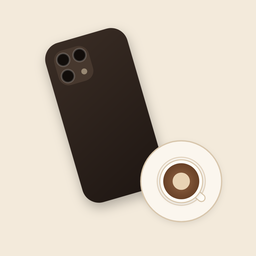
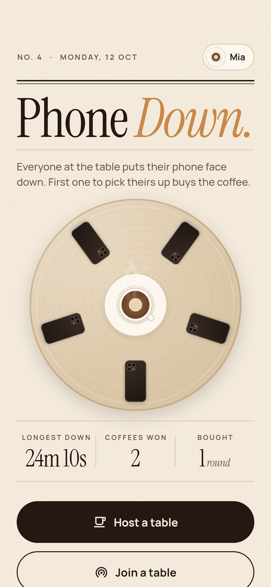
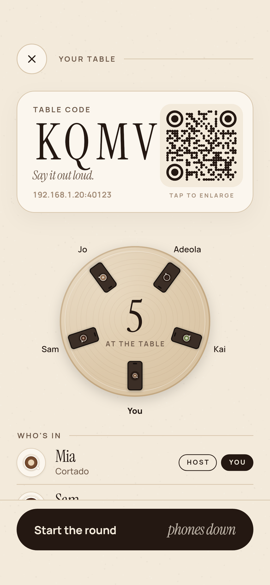
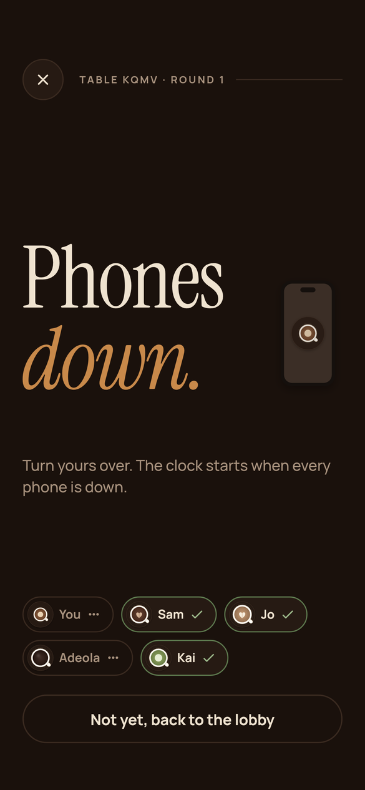
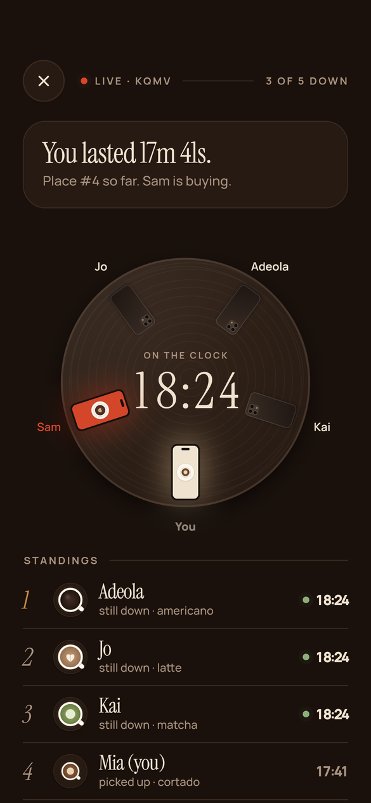
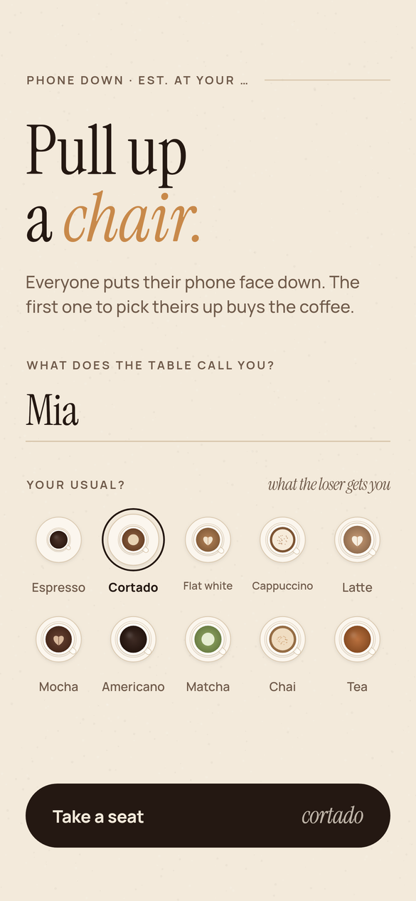
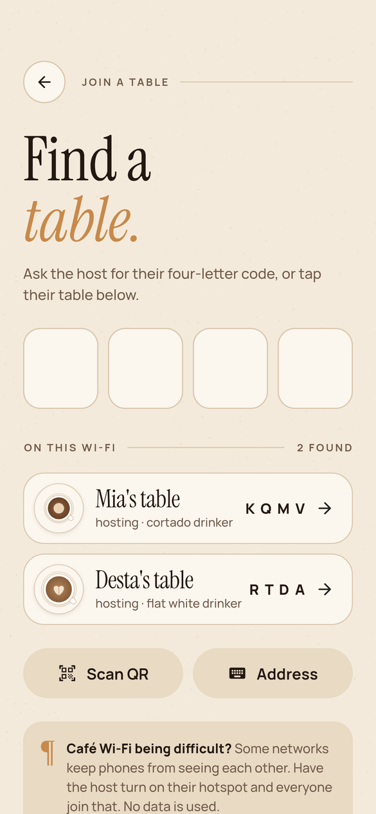
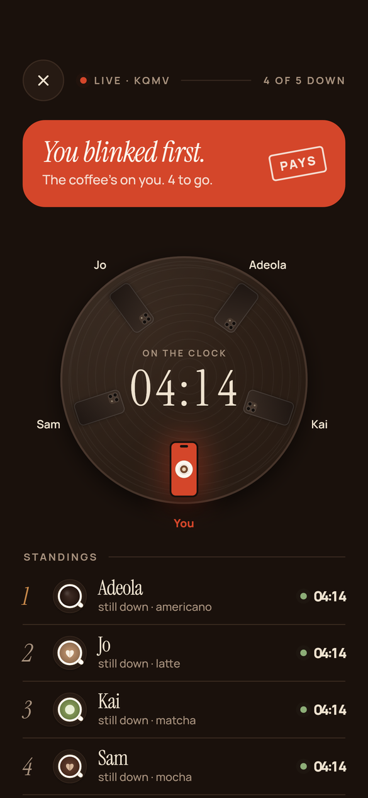
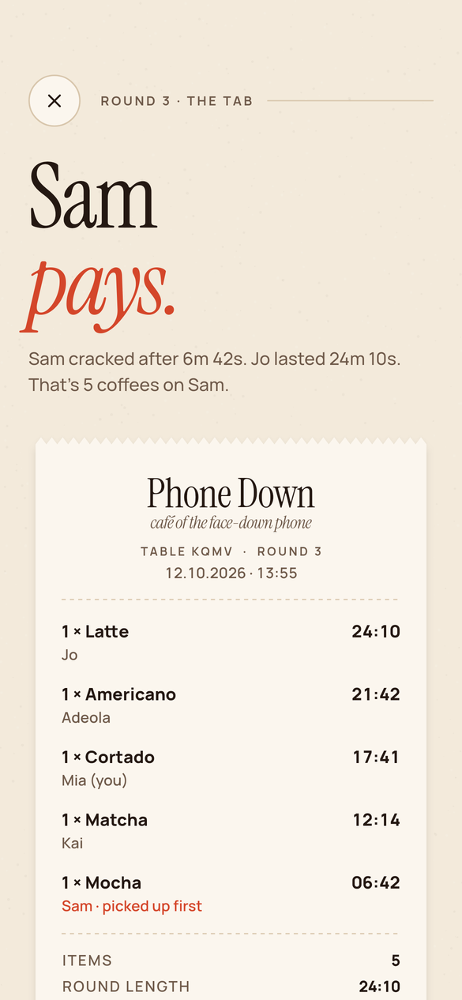

# Phone Down



A coffee table game in Flutter. Everyone opens the app, sits down at the same table, and turns their phone face down. The first one to pick theirs up buys the coffee.

<p>
  
  
  
  
</p>

<p>
  
  
  
  
</p>

- **Your seat.** Pick a name and your usual order. Your order is your avatar, drawn as a cup on a saucer seen from above, and it's what the loser buys you.
- **Host or join.** The host gets a four-letter code to say out loud and a QR code. Phones on the same Wi-Fi see the table under *Join* straight away. You can also type the code, scan the QR, or type the address.
- **The table.** A wooden table seen from above, with everyone's phone around the edge and you at the bottom. Phones flip over when they go face down, then lift and light up when someone picks up. The one who picked up first glows red.
- **Phones down.** The clock only starts once every phone is face down. Then there's a three-second count-in that you feel through haptics, since nobody can see their screen. Lifting during the count just cancels it.
- **The round.** While your phone is down, the screen goes black. Pick it up and you're out, and you see the table, the clock and the live standings. Leaving the app, or walking off with your phone, counts as picking up.
- **Temptation buzz.** This is a house rule the host can turn off. When someone picks up, every phone still face down buzzes. Don't look.
- **The tab.** When everyone's up, or the host calls it, the round ends on a receipt: everyone's order, how long they lasted, who's paying, and a crooked PAID stamp. You can share it as an image. *Again* starts another round at the same table.
- **Your record.** The front page shows your longest time down, coffees won, rounds bought, and a log of recent games.

## How the rooms work

There's no backend and no accounts. Everyone is at the same table, so the phones talk over the local network:

- The host's phone runs the rules (`RoomEngine`) and a small WebSocket server. It sends the full table state to every phone on each change, plus a heartbeat every second so every clock stays in step.
- Tables are announced and found with mDNS/Bonjour (`bonsoir`, service `_phonedown._tcp`). The QR code holds the host's addresses and port, so scanning it works even when discovery doesn't.
- The host's clock decides the times, so every phone agrees on who picked up first.
- If someone drops off the Wi-Fi briefly, they get four seconds to reconnect before it counts as leaving. A rejoining phone keeps its seat.

Some café networks stop phones from seeing each other. In that case the host turns on their hotspot and everyone joins it. Mobile data isn't used.

Screens only talk to `TableSession`, so another transport could be added later without touching the UI. That could be Nearby Connections over Bluetooth on Android, or a Firebase/Supabase room for playing across networks.

## Face-down detection

`FaceDownDetector` reads the accelerometer through `sensors_plus`. A phone lying face down reads about −9.8 on z.

- **Going down** needs a steady reading under −7.8 for 350 ms, so sliding the phone into place doesn't flicker.
- **Coming up** needs a reading above −5.5 for 220 ms. That catches a real pickup but ignores a knock on the table.

While a table is open, the screen is kept awake (`wakelock_plus`), so the sensor keeps reporting while the phone is face down.

In debug builds the arming and live screens show a *Debug: put phone down* button, so you can play on an emulator that has no motion sensor.

## Run it

```bash
flutter pub get
flutter run
```

To play a real round you need two or more phones on the same Wi-Fi or hotspot. *Start solo* lets you try it on one phone.

To build an APK you can install on an Android phone:

```bash
flutter build apk --release
# -> build/app/outputs/flutter-apk/app-release.apk
```

The release build is signed with the debug key, which is fine for installing it yourself. Publishing to the Play Store needs your own signing key.

## Tests

```bash
flutter test
```

The tests cover the rules, the face-down detector, a real host and guest playing a round over sockets, invite links, and the app flow.

## Screenshots and icon

The screens in `docs/screenshots/` are rendered by tests:

```bash
flutter test tool/render --update-goldens   # writes tool/render/out/*.png
```

The icon is drawn in code (`tool/icon/generate_icon_test.dart`). To regenerate it:

```bash
flutter test tool/icon --update-goldens && cp tool/icon/icon_*.png assets/icon/
dart run flutter_launcher_icons
```

## Code

| File | What it does |
| --- | --- |
| `lib/game/room.dart` | Players, phases and the table state sent over the wire |
| `lib/game/room_engine.dart` | The rules: arming, countdown, first-up pays, rematch |
| `lib/game/face_down.dart` | Accelerometer to face down, with debounce |
| `lib/net/session.dart` | `TableSession`, plus `HostSession` (server) and `ClientSession` (joiner) |
| `lib/net/discovery.dart` | mDNS broadcast and discovery |
| `lib/net/invite.dart` | QR code links and LAN addresses |
| `lib/profile.dart` | Name, order and round history, saved on the phone |
| `lib/orders.dart` | The drinks and the top-down cup painter |
| `lib/widgets/table_view.dart` | The table, the seats and the flipping phones |
| `lib/widgets/common.dart` | Buttons, rules, stamps, the clock digits and paper grain |
| `lib/screens/` | Onboarding, home, join (with the QR scanner), and the table screen |
| `lib/screens/views/` | The table screen's pages: lobby, arming, live and the tab |

Design: warm coffee editorial. Cream paper and espresso ink for the room, a dark roast once phones go down, crema for accents and tomato for whoever's paying.

Fonts: [Instrument Serif](https://github.com/Instrument/instrument-serif) for headlines and numbers, and [Manrope](https://github.com/sharanda/manrope) for everything else. Both use the SIL Open Font License; see `assets/fonts/`.
